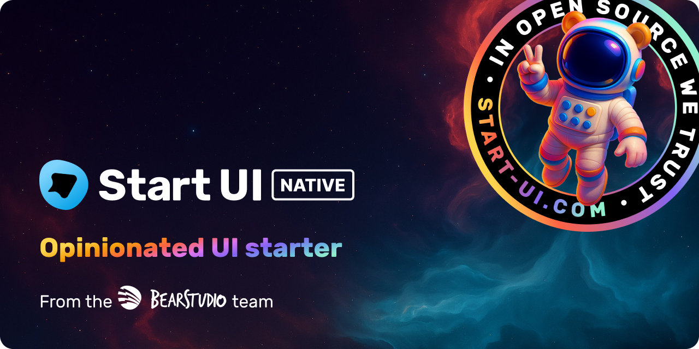
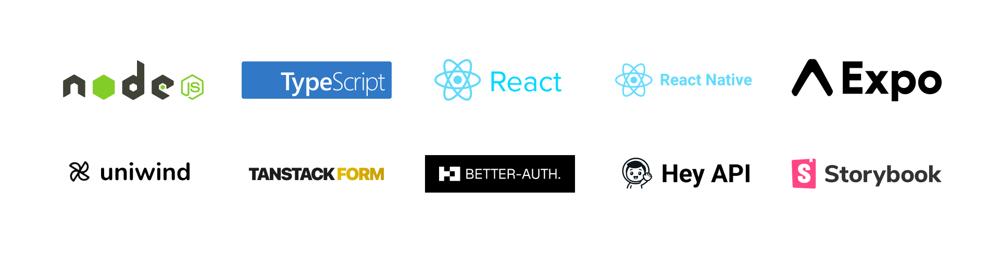
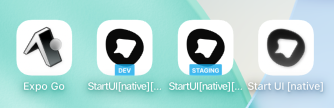

<h1 align="center"></h1>

🚀 Start UI <small>[native]</small> is an opinionated native starter repository created & maintained by the [BearStudio Team](https://www.bearstudio.fr/team) and other contributors.
It represents our team's up-to-date stack that we use when creating native apps for our clients.

# Technologies


<div align="center" style="margin: 0 0 16px 0"></div>

[⚙️ Node.js](https://nodejs.org), [🟦 TypeScript](https://www.typescriptlang.org/), [⚛️ React](https://react.dev/), [📱 React Native](https://reactnative.dev/), [🚀 Expo SDK 58](https://docs.expo.dev/), [🔐 Better Auth](https://www.better-auth.com/), [🖌️ Uniwind](https://uniwind.dev), [🧱 React Native Reusables](https://reactnativereusables.com), [🌴 Tanstack Form](https://tanstack.com/form/), [🌴 Tanstack Query](https://tanstack.com/query/), [👋 Hey API](https://heyapi.dev/)

> [!NOTE]
> OTA updates use `runtimeVersion: { policy: 'fingerprint' }` (balanced preset). New native binaries are required when the fingerprint changes.

## Over-the-air (OTA) updates

In release builds where `expo-updates` is enabled, the app checks for a newer update when it returns to the foreground (`AppState` → `active`). When an update is available, a small banner at the top of the screen lets users download and reload immediately (or reload if the update was already downloaded). The banner is hidden in development and when updates are disabled (for example Expo Go).

GitHub Actions publish updates per EAS channel:

| Channel / workflow | EAS `--environment` | `APP_ENV` (app.config) | Notes |
| ------------------ | --------------------- | ---------------------- | ----- |
| **development** (manual EAS Update workflow) | `development` | `development` | Matches the development build profile |
| **staging** (manual EAS Update workflow) | `preview` | `staging` | Staging channel uses the EAS preview environment for server-side env vars |
| **production** (manual EAS Update workflow) | `production` | `production` | Store / production builds |
| **PR branch** (EAS Preview workflow) | `preview` | `staging` | Publishes to the PR head branch; uses staging app identifiers |

### Expo / EAS setup

Follow these steps after forking so OTA updates work end to end. Official references: [EAS Update](https://docs.expo.dev/eas-update/getting-started/), [environment variables](https://docs.expo.dev/eas/environment-variables/), [GitHub Actions with Expo](https://github.com/expo/expo-github-action).

1. **Create or link an EAS project**

   ```bash
   npm install -g eas-cli   # or: pnpm add -g eas-cli
   eas login
   eas whoami
   eas init                 # create a new project, or link an existing one
   # Link to a project you already created on expo.dev:
   # eas init --id <your-eas-project-id>
   ```

   In `app.config.ts`, replace Bear Studio values with your own:

   | Field | Purpose |
   | ----- | ------- |
   | `EAS_PROJECT_ID` | UUID from [expo.dev](https://expo.dev) → your project → **Project settings** |
   | `owner` | Expo account or organization slug |
   | `PROJECT_SLUG` | Project slug on Expo (must match the linked project) |
   | `updates.url` | `https://u.expo.dev/<EAS_PROJECT_ID>` (keep in sync with the project ID) |
   | `extra.eas.projectId` | Same UUID as `EAS_PROJECT_ID` |

2. **Configure EAS Update**

   ```bash
   eas update:configure
   ```

   This command adds or updates `updates.url`, `runtimeVersion`, and `extra.eas.projectId` in your app config ([docs](https://docs.expo.dev/eas-update/getting-started/#configure-your-project)).

   This repo already sets `runtimeVersion: { policy: 'fingerprint' }` instead of a fixed string. The fingerprint changes when native dependencies or config change, so users need a **new `eas build`** for those changes; JavaScript-only fixes can ship via `eas update`.

3. **Channels, branches, and build profiles**

   Each `eas.json` build profile pins a **channel** (embedded in the binary at build time):

   | Profile | Channel in `eas.json` |
   | ------- | --------------------- |
   | `development` | `development` |
   | `staging` | `staging` |
   | `production` | `production` |

   On EAS, a **channel** points at an **update branch** (where `eas update` publishes). By default, channel and branch names often match; verify or fix the mapping:

   ```bash
   eas channel:list
   eas branch:list
   # Point channel "staging" at branch "staging" (example):
   eas channel:edit staging --branch staging
   # Create a channel or branch if missing:
   eas channel:create staging
   eas branch:create staging
   ```

   **PR previews:** the [EAS Preview](.github/workflows/eas-preview.yml) workflow runs `eas update` on the **PR head branch** name. A device only receives that update if its installed build’s channel is pointed at that branch (via `eas channel:edit`), or you open the update using the **preview link / QR code** from the GitHub PR comment (development client or compatible preview flow). Production/staging channel builds do not automatically subscribe to arbitrary PR branch names.

4. **EAS environments and variables**

   EAS provides three environments: `development`, `preview`, and `production`. For **SDK 55+**, `eas update` must pass `--environment` so the job uses the matching variables ([docs](https://docs.expo.dev/eas/environment-variables/#quick-start)).

   This starter’s CI maps **update channel → EAS environment** as follows (staging channel uses EAS `preview` because there is no separate `staging` environment on Expo):

   | Update target | `--environment` | `APP_ENV` at publish time |
   | ------------- | ----------------- | ------------------------- |
   | `development` channel | `development` | `development` |
   | `staging` channel | `preview` | `staging` |
   | `production` channel | `production` | `production` |
   | PR preview workflow | `preview` | `staging` |

   Set project variables on [expo.dev](https://expo.dev) → your project → **Environment variables**, or with the CLI:

   ```bash
   # Required for the app bundle (see src/env.ts)
   eas env:set --name EXPO_PUBLIC_BASE_URL --value https://your-api.example.com --environment production --visibility plaintext

   # Optional overrides (defaults are derived from EXPO_PUBLIC_BASE_URL in src/env.ts)
   eas env:set --name EXPO_PUBLIC_AUTH_URL --value https://your-api.example.com/api/auth --environment production --visibility plaintext
   eas env:set --name EXPO_PUBLIC_OPENAPI_URL --value https://your-api.example.com/openapi/app/schema --environment production --visibility plaintext
   eas env:set --name EXPO_PUBLIC_API_URL --value https://your-api.example.com/api/rest --environment production --visibility plaintext

   # Baked into app.config.ts at update/build time (icons, bundle ID, scheme)
   eas env:set --name APP_ENV --value production --environment production --visibility plaintext
   ```

   Repeat for `development` and `preview` with values appropriate to each environment (`APP_ENV` should be `development`, `staging`, or `production` to match the flavor you are publishing).

   GitHub Actions workflows read `EXPO_PUBLIC_*` from repository **Variables** (`API_URL`, `AUTH_URL`, `OPENAPI_URL`); keep those aligned with your EAS variables for CI publishes.

5. **GitHub Actions: `EXPO_TOKEN` and permissions**

   1. Create an [access token](https://docs.expo.dev/accounts/programmatic-access/) on expo.dev (robot or personal token with access to the project).
   2. Add it as repository secret **`EXPO_TOKEN`** ([Settings → Secrets and variables → Actions](https://docs.github.com/en/actions/security-for-github-actions/security-guides/using-secrets-in-github-actions)).
   3. Configure [GitHub variables](#variables) (`API_URL`, etc.) as documented below.
   4. **EAS Preview** needs `permissions: pull-requests: write` and `contents: read` so `expo/expo-github-action/preview` can comment on PRs (already set in `.github/workflows/eas-preview.yml`).

6. **Install a release binary before OTA**

   Updates apply only to builds that include `expo-updates` with your channel and runtime version. Build and install once per channel you use:

   ```bash
   eas build --profile development --platform ios    # or android, or --platform all
   eas build --profile staging --platform all
   eas build --profile production --platform all
   ```

   OTA does **not** apply in **Expo Go**, in Metro dev mode (`__DEV__`), or when `expo-updates` is disabled; the in-app banner is hidden in those cases.

7. **Test the flow (staging example)**

   1. Install a **staging** build (`eas build --profile staging` + internal distribution).
   2. Publish an update: GitHub Actions → **EAS Update** → channel `staging`, or locally:

      ```bash
      APP_ENV=staging eas update --branch staging --environment preview --message "Test staging OTA" --non-interactive
      ```

   3. Open the staging app, send it to the background, then foreground again (triggers `checkForUpdateAsync`).
   4. When the banner appears, tap **Update** (or **Reload** if the update was already downloaded) and confirm the app reloads with your change.

# Requirements

- [Node.js](https://nodejs.org) >= 22
- [pnpm](https://pnpm.io/)

# Getting Started

```bash
pnpm create start-ui -t native myApp
```

That will scaffold a new folder with the latest version of 🚀 Start UI [native] 🎉

# Installation

```bash
cp .env.example .env # Setup your env variables
cp .vscode/settings.example.json .vscode/settings.json  # (Optionnal) Setup your VS Code
pnpm install # Install dependencies
```

## Environment variables

> [!TIP]  
> Using Expo Go, local development urls should not be `localhost`, use public IP instead

```bash
EXPO_PUBLIC_BASE_URL # Base URL of your server, useful if you are using Start UI [web]

# OPTIONAL TO OVERRIDE
EXPO_PUBLIC_AUTH_URL # Better-auth url (default `${EXPO_PUBLIC_BASE_URL}/api/auth`)
EXPO_PUBLIC_OPENAPI_URL # OpenAPI contract URL (default `${EXPO_PUBLIC_BASE_URL}/openapi/app/schema`)
```

## API SDK generation

```bash
pnpm gen:api
```

A new folder `/src/lib/hey-api/generated` will be created with stuff like to combine use Tanstack Query to fetch data, based on env variables.

For example

```ts
import { api } from '@/lib/hey-api/api';

useQuery(api.bookGetByIdOptions({ path: { id: props.bookId } }));
```

# Run

### Expo Go (quickstart)

Use Expo Go to explore the app quickly — no native build required.

```bash
pnpm dev
```

> [!NOTE]
> **SDK 58:** Expo Go for this SDK is rolling out to the App Store and Google Play over the coming weeks. Until your device has an SDK 58–compatible Expo Go build, use the **development client** (`pnpm dev:client`) instead of `pnpm dev` / Expo Go.

> [!NOTE]
> Expo Go does not support all native modules (e.g. `expo-secure-store`, Better Auth flows). For day-to-day development, use the **development client** below.

### Development client (recommended)

The development client is the recommended path for real work: it matches production more closely and supports Better Auth, secure storage, and other native modules.

**1. Build the client** (once per machine, or when native dependencies change):

```bash
# Local build (requires Xcode / Android SDK)
pnpm dev:build:ios
pnpm dev:build:android

# Or via EAS (GitHub Actions → "EAS Development build", or locally):
eas build --profile development
```

**2. Start Metro for the dev client:**

```bash
pnpm dev:client
```

Open the installed dev client app on your device or simulator — it will connect to the Metro bundler.

### Local builds

App name and bundle ID come from `app.config.ts`, evaluated at **prebuild** time. Each script runs `prebuild --clean` with the appropriate `APP_ENV`, then builds.


| Script                                              | App name                    | Build type | Need                                      |
| --------------------------------------------------- | --------------------------- | ---------- | ----------------------------------------- |
| `dev:build:ios` / `dev:build:android`               | Start UI [native] [Dev]     | Dev/Debug  | Build the development client locally      |
| `build:staging:ios` / `build:staging:android`       | Start UI [native] [Staging] | Release    | Install staging release version locally   |
| `build:production:ios` / `build:production:android` | Start UI [native]           | Release    | Install production version locally        |


```bash
# Development (debug build, dev client)
pnpm dev:build:ios
pnpm dev:build:android

# Staging (release build, internal testing)
pnpm build:staging:ios
pnpm build:staging:android

# Production (release build, store-like)
pnpm build:production:ios
pnpm build:production:android
```

> [!TIP]
> If the app name is wrong, the native project was generated with the wrong `APP_ENV`. Re-run the same build script — it includes `--clean` to regenerate the native project.

<h1 align="center"></h1>

### Devtools

You can use @dev-plugins pressing `Shift + m` in your Expo terminal.

**[expo-device-hub](https://github.com/expo/expo-device-hub)** streams and controls iOS simulators and Android emulators in the browser. It is installed as a dev dependency and is not bundled into release builds.

- Start the dev server with `pnpm dev:client` or `pnpm start` / `expo start`, then open the **Expo Device Hub** URL printed in the terminal (the host is your dev server address — often a LAN IP, or `127.0.0.1` when using `--localhost` — not necessarily `localhost`).
- Or run it standalone: `npx expo-device-hub`.
- iOS simulators require **macOS** with **Xcode**. Android emulators require the **Android SDK**, including the `emulator` and `adb` tools.

## Storybook

Storybook is managed as a specific mode of the app that is launch apart in port 8083

```bash
pnpm dev:storybook   # Run the app in storybook mode (port 8083)
pnpm storybook:generate  # Regenerate .rnstorybook/storybook.requires.ts after adding stories
```

> [!NOTE]
> Storybook uses Expo Go (`expo start --go`). Same SDK 58 Expo Go rollout applies — use a dev client build if Expo Go on your device is not on SDK 58 yet.

> [!TIP]
> You can open Storybook in another tab and switch between the app and Storybook by pressing `i` or `a` in each terminal.

## Generate custom icons components from svg files

Put the custom svg files into the `app/components/icons/svg-sources` folder and then run the following command:

```bash
pnpm gen:icons
```

If you want to use the same set of custom duotone icons that Start UI is already using, checkout
[Phosphor](https://phosphoricons.com/)

> [!WARNING]
> All svg icons should be svg files prefixed by `icon-` (example: `icon-externel-link`) with **square size** and **filled with `#000` color** (will be replaced by `currentColor`).

# GitHub repository configuration

The GitHub Actions workflows require the following configuration.

## Variables

Add at **Settings → Secrets and variables → Actions → Variables**:


| Variable         | Description                                                                          | Used by                                                       |
| ---------------- | ------------------------------------------------------------------------------------ | ------------------------------------------------------------- |
| `API_URL`        | Base URL of your API server                                                          | EAS builds, preview, update, code quality, prepare-production |
| `AUTH_URL`       | Better Auth URL (e.g. `https://your-api.com/api/auth`)                               | EAS builds, preview, update, code quality, prepare-production |
| `OPENAPI_URL`    | OpenAPI schema URL (e.g. `https://your-api.com/openapi/app/schema`)                  | EAS builds, preview, update, code quality, prepare-production |
| `ASC_API_KEY_ID` | App Store Connect API Key ID (e.g. `H3KZ2V5L32`) for the Release Production workflow | prepare-production                                            |


## Secrets

Add at **Settings → Secrets and variables → Actions → Secrets**:


| Secret                      | Description                                                              | Used by                                                           |
| --------------------------- | ------------------------------------------------------------------------ | ----------------------------------------------------------------- |
| `EXPO_TOKEN`                | Expo access token for EAS CLI                                            | EAS build, development build, update, preview, prepare-production |
| `APP_STORE_CONNECT_API_KEY` | Base64-encoded App Store Connect API key (.p8 file) for store submission | prepare-production                                                |


Create an Expo token at [expo.dev/accounts/{account}/settings/access-tokens](https://expo.dev/accounts/_/settings/access-tokens).

For `APP_STORE_CONNECT_API_KEY`: export your App Store Connect API key as base64 (`base64 -i AuthKey_XXX.p8`) and store the result as the secret. The prepare-production workflow decodes it at runtime for `eas submit`.

For the **Release Production** workflow, also configure `eas.json` submit.production with your App Store Connect credentials (`ascAppId`, `ascApiKeyId`, `ascApiKeyIssuerId`, `ascApiKeyPath`), and set the `ASC_API_KEY_ID` variable to match your key ID (used in the key filename).

## Workflows


| Workflow                  | Trigger      | Description                                                                             |
| ------------------------- | ------------ | --------------------------------------------------------------------------------------- |
| **EAS build**             | Manual       | Build app — select profile (development, staging, production) in the GitHub UI          |
| **EAS Development build** | Manual       | Build development client (internal)                                                     |
| **EAS Update**            | Manual       | Publish OTA update — select channel (development, staging, production) in the GitHub UI |
| **EAS Preview**           | Pull request | Publish preview update on PR branch                                                     |
| **Release Production**    | Manual       | Build production, then submit to App Store and Play Store                               |


### EAS build profiles


| Profile         | Purpose                                                                  |
| --------------- | ------------------------------------------------------------------------ |
| **development** | Dev client for local development (internal distribution)                 |
| **staging**     | Internal distribution for testers (never sent to stores)                 |
| **production**  | Store build (auto-increments, submitted via Release Production workflow) |


# EAS Preview

To be able to use previews on PR, you have to setup your project with EAS

1. Configure [GitHub variables and secrets](#github-repository-configuration) (see above)
2. Setup Expo project: [https://expo.dev/](https://expo.dev/)
  - Create your project
    - Get project's id
    - Set as `EAS_PROJECT_ID` in `app.config.ts`
3. Setup eas
  - `eas login`
    - `eas init --id {projectid}`
    - `eas update:configure`

